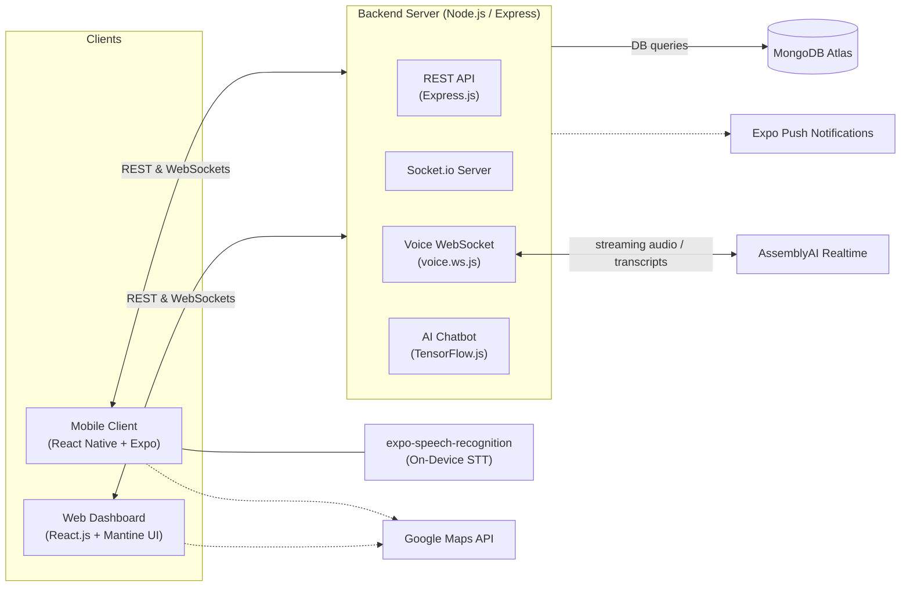
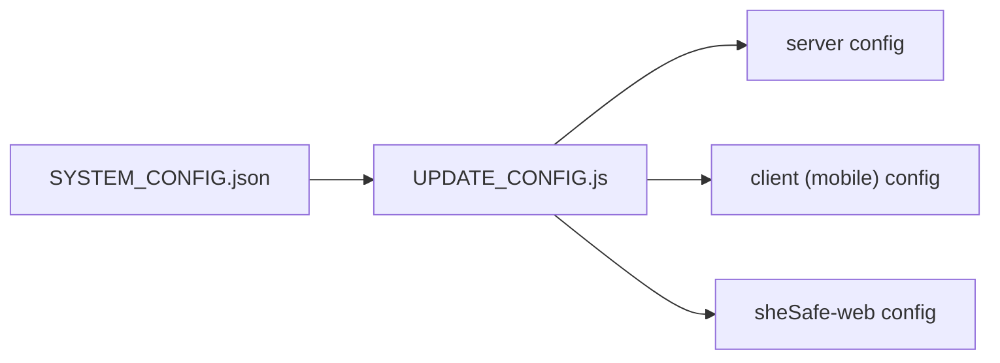

# SheSafe — System Architecture

SheSafe is built on a modern, decoupled client-server architecture, enabling real-time communication, scalable background processing, and cross-platform mobile support.

## High-Level Architecture Diagram

---

## 1. Client Tier

The client tier is split into two distinct applications.

### Mobile Application (`client/` folder)

Built using **React Native** and **Expo**. It handles the core user interactions for personal safety.

- **Native Modules:** Interfaces directly with device hardware for GPS location tracking (`expo-location`), on-device speech recognition (`expo-speech-recognition`), image selection (`expo-image-picker`), and contacts integration.
- **Real-Time Comm:** Maintains a persistent Socket.io connection to the backend to emit SOS alerts and live location updates.

### Web Application (`sheSafe-web/` folder)

Built using **React.js** and **Mantine UI**. It acts as a high-fidelity administrative monitoring terminal.

- **Live Terminal:** A real-time incident queue that pulses and alerts administrators when an SOS is triggered.
- **Safety Analytics:** Provides deep insights into regional safety metrics, response times, and system efficiency using dynamic charts and data rings.
- **Branch Profile:** Manages administrative branch credentials and GPS synchronization.
- **State Management:** Subscribes to Socket.io channels to receive real-time emergency broadcasts and refetch incident details automatically.

---

## 2. Server Tier (`server/` folder)

The backend is a Node.js application serving two primary roles.

### REST API (Express.js)

- Handles traditional CRUD operations (user authentication, profile management, SOS history).
- **AI Chatbot Engine:** Integrates TensorFlow.js (`tfjs-node`) for natural language classification.
- **Distance Filtering Logic:** Uses the `geolib` library and a global `METER_RADIUS` configuration to filter alerts based on proximity to administrative branches.

### Real-Time Servers

- **Socket.io Server:** Manages real-time event rooms. Broadcasts SOS events globally to admins and specifically to the victim's emergency contacts.
- **Voice WebSocket Server** (`server/socket/voice.ws.js`): Receives streamed audio from the mobile client and relays it to AssemblyAI (see section 5).

---

## 3. Configuration & Synchronization (`SYSTEM_CONFIG.json`)

SheSafe uses a centralized configuration system to ensure consistency across the mobile app, web dashboard, and server.

- **Centralized Config:** A root `SYSTEM_CONFIG.json` file contains global network settings (IP, ports) and business logic variables (`METER_RADIUS`).
- **Auto-Sync Engine:** The `UPDATE_CONFIG.js` script automatically propagates these settings into the respective configuration files of all three modules, preventing "out-of-sync" connection errors.

---

## 4. Data Tier

**MongoDB (Atlas):** A NoSQL cloud database used to store unstructured and semi-structured data.

| Collection | Contents |
|---|---|
| **Users** | Hashed passwords, profiles, and auth tokens. |
| **Contacts** | Relationships between users and their emergency contacts. |
| **Alerts** | History of SOS triggers, timestamps, and the sequence of GPS coordinates associated with each emergency, for post-incident review. |

---

## 5. Third-Party Integrations

| Service | Used for |
|---|---|
| **Google Maps API** | Used on both mobile and web clients for rendering interactive maps, calculating routes, and geocoding coordinates into human-readable addresses. |
| **AssemblyAI Realtime** | Powers the backend voice recognition server (`server/socket/voice.ws.js`). Provides high-fidelity, low-latency transcription of streaming audio from the mobile client to detect safety trigger phrases. |
| **Expo Push Notifications** *(planned/active)* | Delivers off-screen alerts to emergency contacts. |
