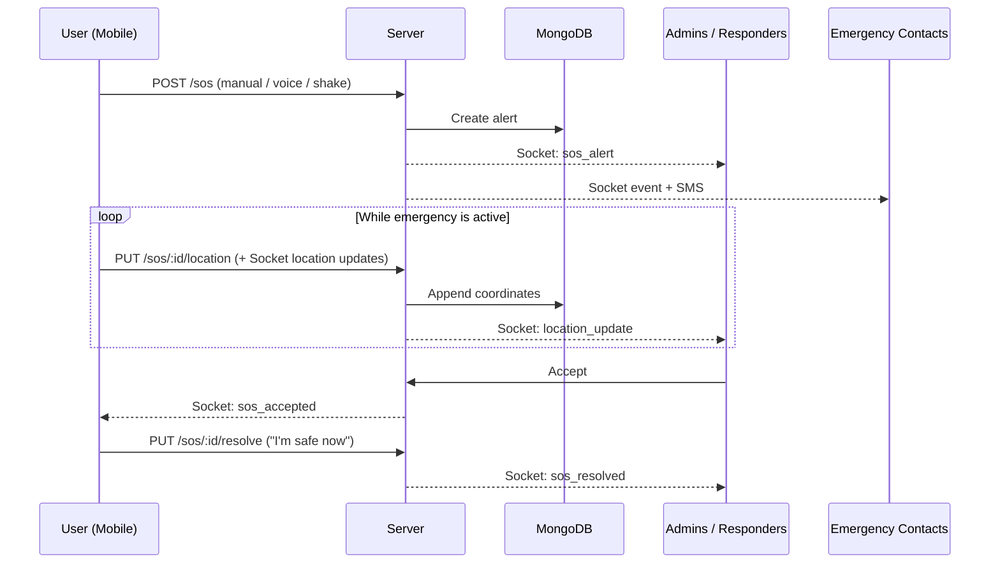

# SheSafe — Backend + Mobile App Documentation

SheSafe is a personal safety platform. A user can trigger an SOS manually, by voice, or by shaking the phone. The backend then alerts responders and the user's emergency contacts in real time and tracks the user's live location until they are safe.

This build contains the **backend server** and the **mobile app**. The web dashboard (`sheSafe-web/`) is intentionally left out. For the full design, see [ARCHITECTURE.md](ARCHITECTURE.md).

## Table of contents

1. [Features](#1-features)
2. [Tech stack](#2-tech-stack)
3. [Project structure](#3-project-structure)
4. [Prerequisites](#4-prerequisites)
5. [Configuration](#5-configuration)
6. [Backend setup](#6-backend-setup-server)
7. [Mobile app setup](#7-mobile-app-setup-client)
8. [How an SOS works](#8-how-an-sos-works)
9. [REST API reference](#9-rest-api-reference)
10. [Real-time events](#10-real-time-events)
11. [Data model](#11-data-model)
12. [Troubleshooting](#12-troubleshooting)

---

## 1. Features

| Feature | How it works |
|---|---|
| **Manual SOS** | Long-press the SOS button on `HomeScreen`. |
| **Voice SOS** | `expo-speech-recognition` listens on-device for trigger phrases. `voiceStreamService.js` also streams audio to the backend's AssemblyAI relay as a cloud accuracy backstop. |
| **Shake SOS** | `shakeDetection.js` watches the accelerometer for a firm shake (1.8G threshold). |
| **Active Emergency screen** | Live map, continuous location push over Socket.io and REST, secret audio recording (`audioRecorder.js`), and an "I'm safe now" button to resolve. |
| **Emergency contacts** | Add or remove contacts. They are notified by SMS the moment an SOS fires. |
| **Safety chatbot** | TensorFlow.js intent classifier trained in memory on server boot (no external AI API calls per message). It can trigger an SOS inline. |
| **Anonymous alerts** | Bystanders can report an incident with no account. |
| **Settings** | Profile editing and profile picture picker. |

## 2. Tech stack

| Layer | Technology |
|---|---|
| Mobile | React Native, Expo (Dev Client build), `expo-location`, `expo-speech-recognition`, `expo-image-picker` |
| Server | Node.js, Express, Socket.io, `ws` |
| AI / NLP | TensorFlow.js (`tfjs-node`) |
| Geo | `geolib` (distance filtering with `METER_RADIUS`) |
| Database | MongoDB Atlas |
| Voice | AssemblyAI Realtime |
| Maps | Google Maps API |

## 3. Project structure

```
shesafe/
├── SYSTEM_CONFIG.json     # single source of truth for IP / ports / METER_RADIUS
├── UPDATE_CONFIG.js       # propagates SYSTEM_CONFIG.json -> server/.env and client config
├── server/                # Node.js backend
└── client/                # React Native (Expo) mobile app
```

## 4. Prerequisites

- Node.js and npm
- A MongoDB Atlas cluster (connection string)
- An AssemblyAI API key
- SMS provider credentials (for contact notifications)
- A Google Maps API key
- Android Studio (Android) or Xcode (iOS) for the Dev Client build
- A phone or emulator on the same network as the backend machine

## 5. Configuration

All shared settings live in the root `SYSTEM_CONFIG.json`: server IP, ports, and `METER_RADIUS`.

After editing it, run from the repo root:

```bash
node UPDATE_CONFIG.js
```

This rewrites the port and radius values in `server/.env` and regenerates `client/src/config/systemConfig.js`, so both modules always agree. Make sure `SERVER_IP` points at the machine running the backend.

### Server environment variables (`server/.env`)

Copy `.env.example` to `.env` and fill in:

| Variable | Purpose |
|---|---|
| `MONGO_URI` | MongoDB Atlas connection string |
| `JWT_SECRET` | Secret for signing auth tokens |
| `ASSEMBLYAI_API_KEY` | Voice transcription |
| SMS credentials | Contact notifications |

## 6. Backend setup (`/server`)

```bash
cd server
npm install
cp .env.example .env      # fill in the values above
npm run dev               # nodemon server.js
```

What starts:

- **REST API** at `http://<host>:5000/api/v1/...` (Express)
- **Socket.io** on the same HTTP server
- **Voice WebSocket** on port `5001` (AssemblyAI relay). It receives streamed mic audio and auto-creates an SOS the moment a trigger phrase is transcribed.
- **TensorFlow.js chatbot**, trained in memory at boot

## 7. Mobile app setup (`/client`)

```bash
cd client
npm install
npx expo install          # aligns native module versions with the installed Expo SDK
npx expo prebuild         # once; custom native modules require a Dev Client build
npx expo run:android      # or: npx expo run:ios
```

Expo Go will not work, because the app uses custom native modules.

## 8. How an SOS works



Alerts are filtered by distance: `geolib` and `METER_RADIUS` decide which administrative branches are close enough to receive them.

## 9. REST API reference

Base path: `/api/v1`

| Method | Path | Auth | Description |
|---|---|---|---|
| POST | `/auth/register` | none | Register an end user |
| POST | `/auth/login` | none | End-user login |
| POST | `/auth/admin/login` | none | Responder login (token still issued without a web UI) |
| POST | `/sos` | user | Trigger an SOS (manual / voice / shake) |
| PUT | `/sos/:id/location` | user | Stream live coordinates during an active emergency |
| PUT | `/sos/:id/resolve` | user | Mark safe |
| GET | `/sos/active` | admin | Live queue of active emergencies |
| POST | `/users/me/contacts` | user | Add an emergency contact |
| POST | `/chatbot/message` | user | Send a message to the safety chatbot |
| POST | `/anonymous-alerts` | none | Bystander report |

## 10. Real-time events

| Event | Meaning |
|---|---|
| `sos_alert` | A new SOS was triggered |
| `location_update` | New coordinates for an active SOS |
| `sos_accepted` | A responder accepted the SOS |
| `sos_resolved` | The user marked themselves safe |
| `anonymous_alert` | A bystander report was received |

## 11. Data model

| Collection | Stores |
|---|---|
| **Users** | Hashed passwords, profiles, auth tokens |
| **Contacts** | User-to-emergency-contact relationships |
| **Alerts** | SOS history, timestamps, and the GPS coordinate sequence for post-incident review |

## 12. Troubleshooting

| Problem | Likely fix |
|---|---|
| App can't reach the server | Re-check `SERVER_IP` in `SYSTEM_CONFIG.json`, run `node UPDATE_CONFIG.js`, and confirm phone and computer share a network. |
| Native module errors | Run `npx expo install`, then rebuild with `npx expo prebuild` and `npx expo run:android` / `run:ios`. |
| Voice SOS not triggering | Check `ASSEMBLYAI_API_KEY`, microphone permission, and that port `5001` is reachable. |
| Ports or radius out of sync | Edit only `SYSTEM_CONFIG.json`, then re-run `node UPDATE_CONFIG.js`. |
